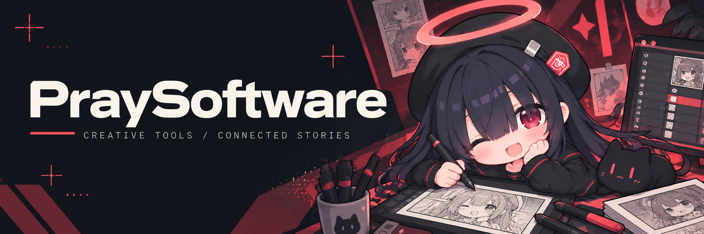

  

<h1 align="center">祈愈工造 · PraySoftware</h1>

  <b>以代码描绘世界，让热爱触手可及。</b> 
  面向图像创作与漫画协作，构建创作者自己的工具。

<a href="https://praysoftware.moe">praysoftware.moe</a>

---

### 关于我们

祈愈工造关注漫画、文字与软件。从画面编辑到团队协作，我们希望把创作过程中反复遇到的问题，变成可以认真解决的工程问题。

让工具贴近创作者的习惯，让故事跨越语言，也让每一次协作留下清晰的脉络。

### 01 / MobType

**图像编辑器 · 早期开发中 · 暂未公开**

MobType 是一款类 Photoshop 的图像编辑器，基于 **Kotlin、C#、Python 和 TypeScript** 开发。

我们希望为图像创作建立一个细致、顺手的工作空间。从编辑交互到图像处理，让不同语言与工具参与同一套创作流程，让工具服务于画面，而不打断创作。

`Kotlin` · `C#` · `Python` · `TypeScript`

### 02 / Meru

**漫画编辑统筹平台 · 早期开发中 · 暂未公开**

Meru 是一个**基于 GitLab 构建**的全生命流程漫画编辑统筹平台，面向漫画制作与汉化中的多人协作。

我们希望将软件工程中围绕项目组织协作的方式带入漫画制作，让分工、交接与修订围绕同一部作品展开，把分散的制作环节连接成持续推进的工作流。

`GitLab` · `漫画制作` · `多人协作` · `流程统筹`

> 两个项目都还在早期，尚无公开项目页面或代码仓库。后续公开信息将通过工作室官网发布。

### 工程与技术

创作工具之外，我们也在搭建承载作品、账号和内容的基础服务。当前官网与配套服务使用的技术包括：

| 领域 | 技术 |
| :--- | :--- |
| Web 界面 | `TypeScript` · `React` · `Vite` |
| 边缘服务 | `Cloudflare Workers` · `Pages` |
| 数据与文件 | `D1` · `R2` · `KV` · `Drizzle ORM` |
| 工程验证 | `Vitest` · `Cloudflare Workers 测试环境` |

此表为官网及配套服务的技术栈，两个主推项目的技术基础见上方介绍。

我们在意交互反馈、文档与数据的可靠性，以及协作系统中清晰的状态和边界。比起堆叠功能，更希望每一项能力都能在真实创作中派上用场。

### 一起创作的人

| 成员 | 分工 |
| :--- | :--- |
| 彼岸之安可 | 后端 / 嵌字 |
| 提风City | 前端 / CI / CQ |
| C4H7NNaO3S | 日语翻译 |
| papiwoldz | 润色 |

### 保持联系

项目还在慢慢生长。想看看我们的作品、工作室动态与后续进展，欢迎访问 **[祈愈工造官网](https://praysoftware.moe)**。

---

